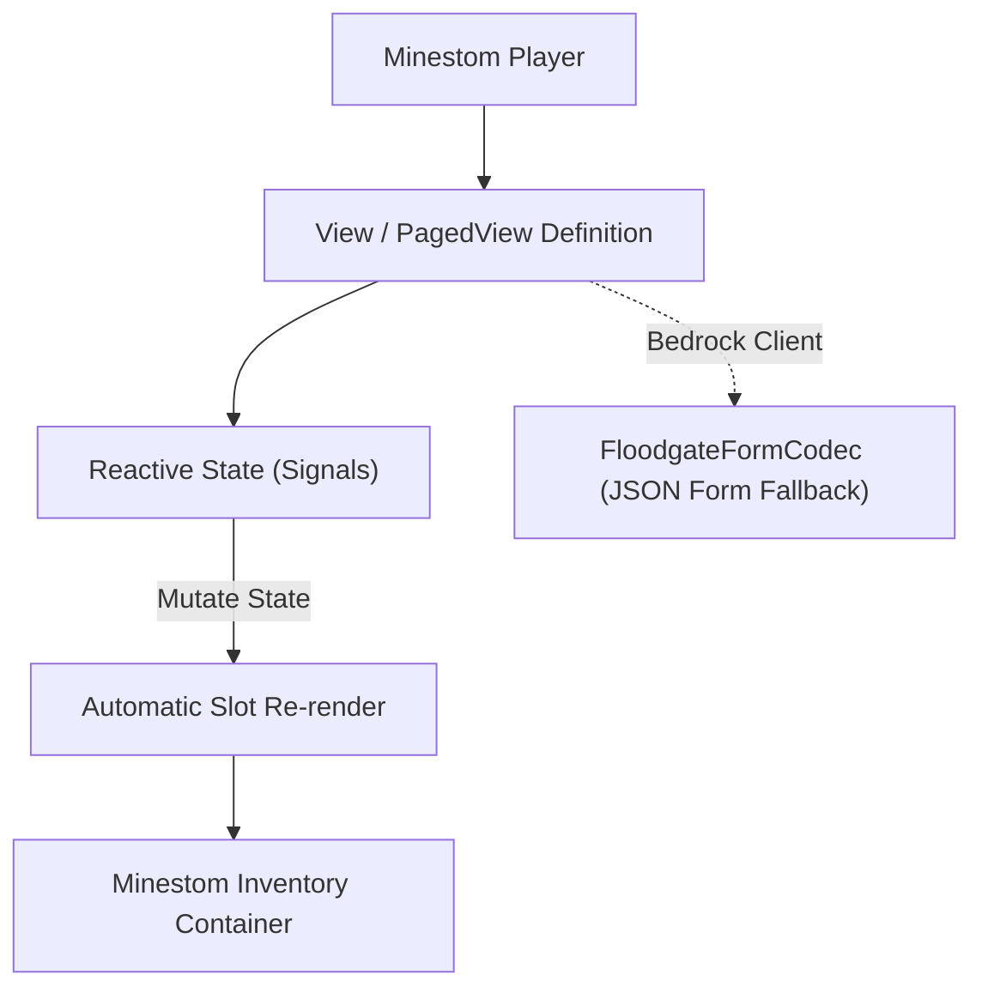

# 🎛️ Univue: Reactive Minestom GUI Framework

> **Declarative, State-Driven Inventory Interface Framework for Minestom with Bedrock Floodgate Form Fallbacks.**  
> *Hard-proof documentation for `libs/univue` (`univue-core` and `univue-minestom`).*

---

## ⚡ 1. Overview & Architecture

`univue` is a reactive inventory UI library designed for Minestom. Instead of manually handling inventory click events and slot arithmetic, interfaces are declared as reactive views with state bindings:



---

## 🛠️ 2. Key Classes & APIs

| Class | Package | Responsibility |
| :--- | :--- | :--- |
| [`Univue`](file:///C:/Users/trapaholics/Documents/GitHub/libs/univue/univue-minestom/src/main/java/dev/terrorify/univue/minestom/Univue.java) | `dev.terrorify.univue.minestom` | Global manager handling inventory listeners and open requests. |
| [`View`](file:///C:/Users/trapaholics/Documents/GitHub/libs/univue/univue-core/src/main/java/dev/terrorify/univue/) | `dev.terrorify.univue` | Base class for single-page reactive inventory menus. |
| [`PagedView`](file:///C:/Users/trapaholics/Documents/GitHub/libs/univue/univue-core/src/main/java/dev/terrorify/univue/) | `dev.terrorify.univue` | Built-in pagination support with next/prev buttons and dynamic item grids. |
| [`FloodgateFormCodec`](file:///C:/Users/trapaholics/Documents/GitHub/libs/univue/univue-core/src/main/java/dev/terrorify/univue/floodgate/) | `dev.terrorify.univue.floodgate` | Automatically converts inventory menus to Bedrock Cumulus JSON modal forms. |

---

## 📋 3. Verified Java Usage Example

```java
import dev.terrorify.univue.minestom.Univue;
import net.minestom.server.entity.Player;
import net.minestom.server.item.ItemStack;
import net.minestom.server.item.Material;

public class ShopMenu {
    public static void open(Player player) {
        // Initialize Univue once at server startup: Univue.init();

        Univue.builder()
            .title("§8Server Store")
            .size(27) // 3 rows
            .item(11, ItemStack.of(Material.DIAMOND_SWORD), (p, click) -> {
                p.sendMessage("§aYou purchased Diamond Sword!");
            })
            .item(15, ItemStack.of(Material.GOLDEN_APPLE), (p, click) -> {
                p.sendMessage("§aYou purchased Golden Apple!");
            })
            .open(player);
    }
}
```

---

## 📖 Canonical Specifications
* **[`.bible/09-shared-libraries-and-apis`](file:///C:/Users/trapaholics/Documents/GitHub/.bible/09-shared-libraries-and-apis)**
